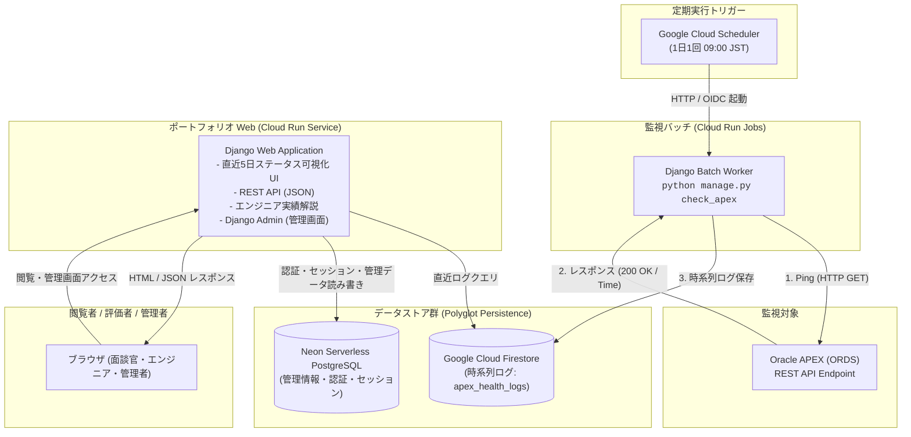

# 【ポートフォリオ企画・設計書】Oracle APEX Keep-Alive & 死活監視システム

**プロジェクト名:** `Apex-Sentinel` (Oracle APEX Uptime & Cloud-Native Observability Dashboard)  
**アーキテクチャ:** Django + Google Cloud Firestore (NoSQL) + Neon (Serverless PostgreSQL) + Cloud Run (Jobs / Service)

---

## 1. プロジェクトの背景・目的

### 1.1 背景と課題
- **Oracle APEX Free Tier の仕様**: 約7日間無通信だとインスタンスが自動休眠・停止される。
- **解決策**: 外部から定期的に REST API へヘルスチェックリクエストを送信し、インスタンスの生存を維持（Keep-Alive）する。

### 1.2 バックエンドエンジニア職種認定でのアピールポイント
単なるバッチスクリプトではなく、**実務で評価されるバックエンド設計思想**を盛り込んだシステムとして構成。

> [!IMPORTANT]
> **職種認定・面談での最重要アピール項目**
> 1. **Polyglot Persistence（3種の適材適所データストア選定）**:
>    - **基幹・監視対象 (RDB)**: Oracle APEX (Autonomous Database)
>    - **時系列監視メトリクス (NoSQL)**: Google Cloud Firestore（書き込み最適化、追記専用、JOIN不要、無料枠活用）
>    - **管理情報・認証・設定 (サーバーレス RDB)**: Neon PostgreSQL（Django Admin・セッションの永続化、Scale-to-Zero による完全$0運用、ステートレスコンテナとの親和性）
> 2. **Django × NoSQL × Serverless RDB のハイブリッド設計**:
>    - Djangoの標準認証・Admin・ORMの恩恵を Neon で享受しつつ、高頻度なログ収集は Firestore SDK（Repository パターン）で疎結合に分離。
> 3. **クラウドネイティブ & FinOps ($0運用)**:
>    - Cloud Run（Service/Jobs）+ Firestore + Neon により、常時起動サーバーを排除し、完全無料枠内でエンタープライズ級の堅牢性を実現。
> 4. **Django カスタム管理コマンドによるバッチ実装**:
>    - バッチ処理を `python manage.py check_apex` として実装し、Cloud Run Jobs から実行。コード資産の共通化とテスト容易性を確保。

---

## 2. 全体システムアーキテクチャ



---

## 3. データストア選定理由（Polyglot Persistence）

なぜ複数のデータベースを組み合わせるのか、技術的理由を明確に定義します。

| データストア | 種別 | 役割・格納データ | 選定理由・技術的メリット |
| :--- | :--- | :--- | :--- |
| **Oracle APEX** | RDB (クラウド) | 監視対象・業務データ | ポートフォリオの対象システム。Autonomous Database の制約（7日休眠）を解消する。 |
| **Google Cloud Firestore** | NoSQL (ドキュメント) | 時系列ヘルスチェックログ | ・追記専用（Append-only）でスキーマレス。<br>・1日5万回読み取り、2万回書き込みが完全無料。<br>・日付範囲や最新N件のクエリが高速。 |
| **Neon** | サーバーレス PostgreSQL | Django Admin、認証、セッション、設定 | ・Cloud Run のステートレス性（複数インスタンス、揮発性ディスク）で SQLite は使えない。<br>・Cloud SQL は月額固定費が発生するが、Neon は Scale-to-Zero で完全$0運用可能。<br>・Supabase のような「1週間放置で手動復帰が必要」な休眠がなく、リクエスト時に自動起動する。 |

---

## 4. データモデル設計

### 4.1 Firestore Collection: `apex_health_logs` (時系列ログ)
- ドキュメントID: `YYYYMMDD-HHmmss` (時系列ソート可能なID)

```json
{
  "id": "20261106-090000",
  "target_url": "https://.../ords/.../v1/health",
  "checked_at": "2026-11-06T09:00:00+09:00",
  "status_code": 200,
  "response_time_ms": 142,
  "is_healthy": true,
  "error_message": null
}
```

### 4.2 Neon (PostgreSQL): Django 管理情報
- Django 標準テーブル群:
  - `auth_user`, `auth_group`, `auth_permission` (管理者アカウント・権限)
  - `django_session` (管理画面セッション)
  - `django_admin_log` (管理画面操作ログ)
  - `django_migrations` (マイグレーション履歴)
- 将来的な拡張テーブル（監視対象エンドポイント設定マスタなど）

---

## 5. アプリケーション設計（全体フォルダ構成）

Web（Cloud Run Service）と定期バッチ（Cloud Run Jobs）を一元管理し、共通ロジックを `services/` に集約した**クリーンかつテスタビリティの高いモノレポ構成**を採用します。

```text
apex-sentinel/
├── config/                      # ⚙️ Django 全体設定
│   ├── __init__.py
│   ├── settings.py              # Neon (DB) / Firestore / 環境変数
│   ├── urls.py                  # Web ルーティング & /admin
│   └── wsgi.py                  # Cloud Run Web 用 WSGI (Gunicorn)
│
├── monitor/                     # 🌐 Web・ダッシュボード アプリケーション
│   ├── models.py                # Django ORM モデル（管理情報・設定マスタ）
│   ├── views.py                 # ダッシュボード画面 & API View
│   ├── urls.py                  # monitor アプリ内ルーティング
│   ├── templates/               # HTML テンプレート (Tailwind CSS)
│   └── static/                  # 静的ファイル
│
├── jobs/                        # ⏱️ 定期実行バッチ (Cloud Run Jobs 用)
│   ├── __init__.py
│   └── check_apex.py            # APEX ヘルスチェック実行ロジック本体
│
├── services/                    # 💡 共通サービス層 (Web と Jobs の両方から再利用)
│   ├── __init__.py
│   ├── apex_client.py           # Oracle APEX (ORDS REST API) との HTTP 通信クラス
│   └── firestore_repo.py        # Firestore (時系列ログ) との読み書き抽象化クラス
│
├── docs/                        # 📚 各種設計・設定手順書
│   ├── portfolio_project_plan.md# 本企画・設計書
│   ├── neon_integration_guide.md# Neon 設定・連携ガイド
│   └── oracle_apex_ords_setup.md# APEX ORDS 仕様書
│
├── AGENTS.md                    # 🛡️ AI エージェント用セキュリティ・開発規約
├── .aiignore                    # AI 自動インデックス除外設定
├── .cursorignore                # Cursor 用除外設定
├── .geminiignore                # Gemini / Antigravity 用除外設定
├── .env.example                 # 環境変数サンプル
├── .env                         # ローカル環境変数（※Git除外・AI不可視）
├── .gitignore                   # Git 除外設定
├── Dockerfile                   # Web / Jobs 共通のマルチコンテナ定義
├── manage.py                    # Django 管理スクリプト
├── pyproject.toml               # uv パッケージ定義
├── uv.lock                      # 厳密な依存関係ロックファイル
└── README.md
```

### 設計のポイント
1. **`services/` の共通化（Clean Architecture）**:
   - `apex_client.py`（APEX通信）と `firestore_repo.py`（Firestore操作）を独立させ、Web と Jobs の両方からインポートして利用。コードの重複を排除。
2. **`jobs/` によるバッチ責務の明確化**:
   - Cloud Run Jobs で実行するスクリプトの実体を `jobs/` 配下に集約。Django のカスタムコマンド（`manage.py`）からもこのロジックを呼び出せるようにして二重化を防止。
3. **1コンテナ・複数ロール（FinOps / CI/CD 最適化）**:
   - Web 実行時はデフォルトの Gunicorn を起動し、Jobs 実行時はコンテナのコマンド引数でバッチを実行。ビルド・デプロイパイプラインを1本化。

---

## 6. 全体タスク一覧（ロードマップ）

今後の実装・環境構築作業の全ステップです。

### Phase 1: データベース・基盤準備
- [x] **Task 1.1: Oracle APEX ORDS REST API 構築・疎通確認**
  - GET エンドポイント作成、curl 疎通テスト完了（[oracle_apex_ords_setup.md](oracle_apex_ords_setup.md)）
- [x] **Task 1.2: Neon アカウント開設 & PostgreSQL インスタンス作成**
  - プロジェクト作成（東京リージョン `AWS ap-northeast-1`）
  - Pooled connection 接続文字列（`DATABASE_URL`）の取得完了（[neon_integration_guide.md](neon_integration_guide.md)）
- [x] **Task 1.3: Google Cloud 環境準備**
  - GCP プロジェクト作成
  - Firestore 有効化（Native モード、東京 `asia-northeast1`）
  - `gcloud auth application-default login` によるローカル疎通完了

### Phase 2: Django プロジェクト基盤実装
- [x] **Task 2.1: パッケージ管理の uv 化 & 依存定義 (`pyproject.toml`, `uv.lock`)**
  - `django`, `psycopg[binary]`, `dj-database-url`, `google-cloud-firestore`, `requests`, `gunicorn`, `whitenoise`, `python-dotenv` 導入完了
- [x] **Task 2.2: セキュリティ規約と環境変数テンプレートの策定**
  - `AGENTS.md`, `.geminiignore`, `.cursorignore`, `.aiignore`, `.env.example` の作成完了
- [x] **Task 2.3: フォルダ構成整備 & Django 設定 (`config/settings.py`)**
  - `config/`, `monitor/`, `jobs/`, `services/` の作成
  - `dj-database-url` による Neon (本番) / SQLite (ローカル) の自動フォールバック設定
  - `whitenoise` による静的ファイル配信設定
- [x] **Task 2.4: 初回マイグレーション & 管理者アカウント作成**
  - Neon への `uv run python manage.py migrate` 完了
  - スーパーユーザー作成（`createsuperuser`）完了

### Phase 3: コア機能実装（バッチ & ダッシュボード）
- [x] **Task 3.1: APEX HTTP クライアント実装 (`services/apex_client.py`)**
  - タイムアウト設定、レスポンスタイム計測、ステータス判定（疎通確認済）
- [x] **Task 3.2: Firestore リポジトリ実装 (`services/firestore_repo.py`)**
  - ログ保存（`save_log`）、直近ログ取得（`get_recent_logs`）（疎通確認済）
- [x] **Task 3.3: バッチジョブ実装 (`jobs/check_apex.py`) & Django コマンド連携**
  - APEX ヘルスチェック実行 $\to$ Firestore 保存（実行成功）
- [x] **Task 3.4: ダッシュボード画面 & REST API 実装**
  - 直近5日稼働インジケーター（Tailwind CSS）
  - 技術解説セクション（構成図・Polyglot Persistence 選定理由）

### Phase 4: コンテナ化 & デプロイ
- [x] **Task 4.1: Dockerfile & .dockerignore 作成 & Docker Compose ローカル検証**
  - uv ベースの超高速マルチステージビルド設定 (`Dockerfile`)
  - Web (Gunicorn) / Batch (Jobs) 兼用 1 イメージ設計
  - WhiteNoise 静的ファイル事前収集 (`collectstatic`) 組み込み
  - ローカル完全自己完結用の `docker-compose.yml` 作成
    - `db`: `postgres:16-alpine` (ローカル用 PostgreSQL)
    - `firestore`: `google/cloud-sdk:emulators` (ローカル用 Firestore Emulator)
    - `web`: Django Web アプリケーション (自動マイグレーション & Gunicorn 起動)
    - `batch`: バッチテスト用コンテナ (`python manage.py check_apex`)
  - ローカルでのコンテナビルド・起動・バッチ実行・Web疎通 (HTTP 200) の検証完了
- [x] **Task 4.2: Cloud Run Service (Web) デプロイ**
  - Secret Manager 連携（Neon 接続文字列、Django 秘密鍵）
  - Cloud Run Service 本番デプロイ完了
  - 公開 URL: `https://apex-sentinel-web-961312396366.asia-northeast1.run.app`
  - ダッシュボード表示 & REST API & Django Admin 疎通確認完了 (HTTP 200)
- [x] **Task 4.3: Cloud Run Jobs (バッチ) デプロイ**
  - `apex-sentinel-batch` ジョブの作成
  - 環境変数 `APEX_HEALTH_URL` 連携
  - クラウド上でのバッチ手動実行テスト成功（APEX 疎通 $\to$ Firestore 保存確認済）
- [x] **Task 4.4: Cloud Scheduler 定期実行設定**
  - 1日1回（JST 09:00）の Cloud Run Jobs トリガー設定完了 (`apex-sentinel-daily-check`)
  - サービスアカウント権限連携 (`roles/run.invoker`)
- [x] **Task 4.5: E2E テスト & 監視自動化の検証**
  - Cloud Scheduler 手動トリガー $\to$ Cloud Run Jobs 自動起動 $\to$ Oracle APEX 疎通 (200 OK) $\to$ Firestore 保存 $\to$ Web ダッシュボード反映の一連フロー動作検証完了（全自動 $0 運用達成）

### Phase 5: 運用強化・CI/CD・UI改善（運用フェーズ）
- [x] **Task 5.1: 本番環境での Django 管理画面 (`/admin`) アクセス制限**
  - 環境変数 `ENABLE_DJANGO_ADMIN` によるハイブリッド制御導入
  - 本番環境（`DEBUG=False` 時）では `/admin/` ルーティング自体を除外して 404 とし完全隠蔽
  - ローカル開発環境（`DEBUG=True`）でのみ管理画面アクセスを許可
- [x] **Task 5.2: GitHub Actions による main マージ時自動デプロイ (CI/CD)**
  - Workload Identity Federation (WIF) による OIDC キーレス認証の導入
  - CI/CD デプロイ専用サービスアカウント（`github-actions-deployer`）の最小権限分離
  - `main` ブランチへの PR マージ時に、Cloud Run Service (Web) 自動デプロイ & Cloud Run Jobs (Batch) イメージ自動同期
  - GitHub Actions コマンドの最新バージョン追従（Node.js 24 対応: `checkout@v7`, `auth@v3`, `setup-gcloud@v3`）
  - Dockerfile のベースイメージ・ビルドツール（Python, uv）の sha256 ダイジェスト固定によるサプライチェーン堅牢化
  - `develop` ブランチでの開発・検証 $\to$ PR による `main` 反映のフロー確立完了
- [x] **Task 5.3: ダッシュボード UI の大幅改善**
  - トップタイトルを「サービス管理画面」に変更し、本サイトの概要・目的をファーストビューに配置
  - 画面内に Mermaid.js によるアーキテクチャ構成図を描画し、面談官や評価者が一目で構造を把握できるように改修
  - 直近 5 回のヘルスチェック実績インジケーターおよび Polyglot Persistence 解説の整理
- [x] **Task 5.4: pytest テストスイートの導入と GitHub Actions CI 自動実行**
  - `pytest`, `pytest-django`, `pytest-mock` によるテスト基盤構築（実行コマンド: `uv run pytest`）
  - インメモリ SQLite (`config/settings_test.py`) による高速かつ安全な独立テスト環境（0.45 秒実行）
  - クライアント通信、Firestore 操作、ビュー、管理者アクセス制御（404）の回帰テスト完備
  - `.github/workflows/ci.yml` による PR / push 時の自動テスト実行（15 秒完了）
- [x] **Task 5.5: 手動ヘルスチェック実行機能の実装（押下後数秒非活性）**
  - `POST /api/check-apex/` による即時ヘルスチェック＆ Firestore 保存
  - UI への「今すぐ手動チェック」ボタンおよび非同期スピナー、ステータス表示の追加
  - 押下後 5 秒間の非活性カウントダウン（disabled）による過剰リクエスト・スパム防止
- [x] **Task 5.6: Dependabot によるセキュリティ自動更新とグループ化・Docker バージョン制御**
  - `.github/dependabot.yml` の導入完了
  - セキュリティアップデートおよび週次保守のグループ化（GitHub Actions, Python, Docker）
  - Dockerfile ベースイメージのメジャーアップデート除外（`semver-major` ignore によるマイナー・パッチのみ PR 化）設定完了
